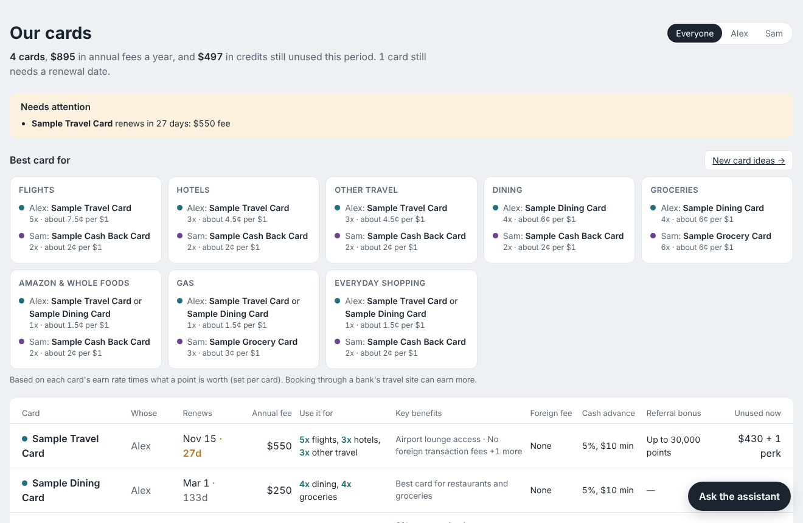

# Card Assistant

A personal dashboard and AI assistant for anyone juggling a lot of credit cards, alone or as a household.
It shows which card to use where, tracks every statement credit so none go unused, warns before
annual fees hit, and suggests new cards and bank bonuses worth a look.

*Shown with sample data.*

## What it does

- **Best card for…** flights, hotels, dining, groceries, Amazon & Whole Foods, gas and everyday shopping, for each person.
- **Every card in one grid**, sorted by renewal date. It shows the annual fee, what to use the card for, key benefits, foreign transaction and cash advance fees, your referral bonus, and credits still unused.
- **Card pages:** built-in benefits (mark them used, see what's left and when they reset) kept separate from limited-time offers.
- **Offers from screenshots:** upload a screenshot of your bank app's offers. Claude reads it, you pick which to save, and each offer stays linked to its screenshot.
- **Add a card by name:** the fee and benefits are looked up online and marked "please check" until you confirm them.
- **New card ideas:** current sign-up bonuses with end dates, cards that beat your current best in a category, and checking account bonuses.
- **Ask the assistant:** a chat built into the page ("Is the Amex Platinum worth its fee?"). It shows every step it took, and it asks before changing anything.
- **Phone access**, password protected, for you and your household.

## Setup

**1. Install Python 3.10 or newer** from [python.org](https://www.python.org/downloads/).
On Windows, tick **"Add python.exe to PATH"** during install.

**2. Download this project.** Click the green **Code** button above, then **Download ZIP**, and unzip it.
(Or: `git clone <this repo's URL>`.)

**3. Start it.**
- **Windows:** double-click **`start.bat`**.
- **Mac:** right-click **`start.command`**, then **Open** (the first time only; after that, double-click).
- **Or in a terminal:** `pip install -r requirements.txt`, then `python dashboard.py`.

Your browser opens the dashboard at http://localhost:8765 with sample cards for "Alex" and "Sam".
Remove them on each card's page and add your own. Type any name as the owner.

**4. Turn on the AI features (optional).** The card lookup, screenshot reading, new card ideas and chat use
Claude. Get an API key at [console.anthropic.com](https://console.anthropic.com/settings/keys)
(pay as you go: a few cents per lookup or question) and paste it into the box at the top of the dashboard.
It's saved only on your computer, in a file called `.env` that's never uploaded.
Everything else works without a key.

## Use it on your phone

Start it with **`start-with-phone.bat`** (Windows) or `python dashboard.py --share`.
The terminal prints a link and a password.

- **Same Wi-Fi:** open the `http://192.168...:8765` link on your phone.
- **Anywhere:** install [Tailscale](https://tailscale.com/download) (free) on the computer and your phone, signed in to the same account.
  Then open the `http://100...:8765` link. To give someone else access, share the computer with them from the Tailscale admin page.

To keep the same password, set `DASHBOARD_PASSWORD` (Windows: `setx DASHBOARD_PASSWORD "your-password"`, then reopen the terminal).
The computer has to be on and awake, with the dashboard running.

## Privacy

Your real data stays on your computer and is excluded from Git by `.gitignore`:
`cards.json`, `offers.json`, `screenshots/`, `credits_used.json`, `suggestions.json`, `transactions.csv`,
`merchant_categories.json`, card backups, `.env` (your API key) and `.simplefin_access`.
The repository only contains code and sample data.

The app never asks for card numbers or logins. When Claude reads a screenshot, the image is sent to
Anthropic's API, so crop out account numbers first.

## How it's built

| File | Job |
| --- | --- |
| `dashboard.py` | The web page and small local server: grid, card pages, ideas page, chat panel, phone sharing |
| `agent.py` | The agent loop: Claude picks a tool, the code runs it, and this repeats until it can answer |
| `prompt.md` | The assistant's rules (its system prompt) |
| `tools.py` | The 14 tools the assistant can use, plus web search |
| `finance.py` | All the math: best card per category, benefit periods, fee dates, missed rewards |
| `cards.py` | Saves and checks the card list |
| `offers.py` | Card-linked offers, including reading them from a screenshot |
| `lookup.py` | Looks up a card's public fee and benefits with web search |
| `suggest.py` | Finds new card ideas, sign-up bonuses and checking account bonuses |
| `categorize.py` | Sorts merchants into categories: word rules first, Claude for the rest, saved |
| `simplefin.py` | Optional: downloads real transactions from [SimpleFIN Bridge](https://beta-bridge.simplefin.org) |
| `tests/`, `evals/` | Quality checks (below) |

**Design decisions**
- **Math in code, judgment in the model.** Rankings, totals and dates are computed in `finance.py`, so numbers are exact. Claude chooses which tool to use and explains the result.
- **Grounded answers.** The rules say every number must come from a tool, never from the model's memory.
- **A person checks the AI.** Looked-up details are flagged "please check", screenshot offers are picked by you, and the chat asks before saving anything.
- **Agent only where it's needed.** Buttons call plain code. Card lookups, screenshots and new card ideas are single, fixed-shape AI calls. Only open-ended chat questions use the agent loop.
- **Small blast radius.** It writes only to local files and has no way to move money or touch a bank account.
- **Rates you actually get.** Bonus rates that need a bank's travel site or one brand (e.g. "8x through Chase Travel") are listed as benefits, not used in rankings.

## Quality checks

| Level | What it checks | Run | Cost |
| --- | --- | --- | --- |
| Logic tests (`tests/`) | Math and rules: best card, fee dates, credit periods, required fields | `python -m pytest` | Free |
| Agent evals (`evals/`) | 12 real questions to the assistant: right tool, right answer, data changed correctly, safety | `python -m evals.run_evals --k 3` | About $1 |

With `--k 3`, a question only counts as passed if all three tries pass (pass^k), because a money assistant
that's right 2 times in 3 isn't good enough. Evals run on a temporary copy of the sample cards, so your
data is never touched.

## Credits

Designed, tested on a real 19-card household, and iterated by Nicole Chang, built with Claude as a coding partner.
Card details come from public sources and change often: always check with your card issuer.
This is information, not financial advice.
